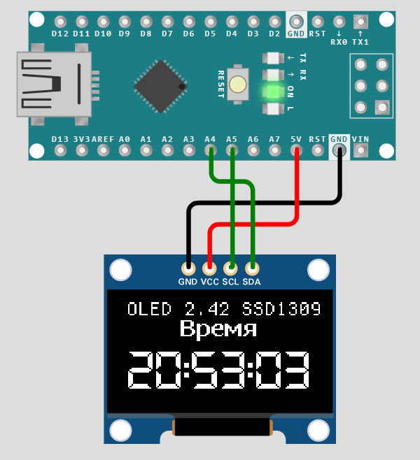
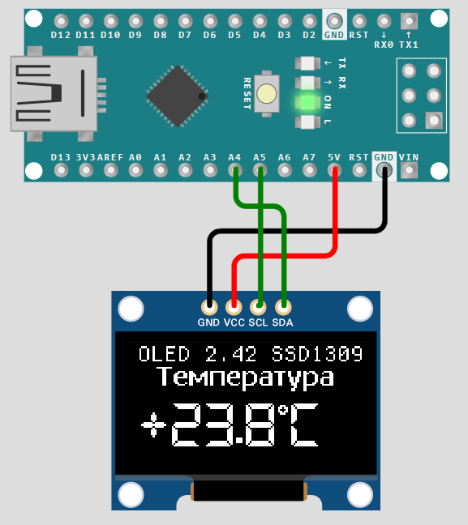
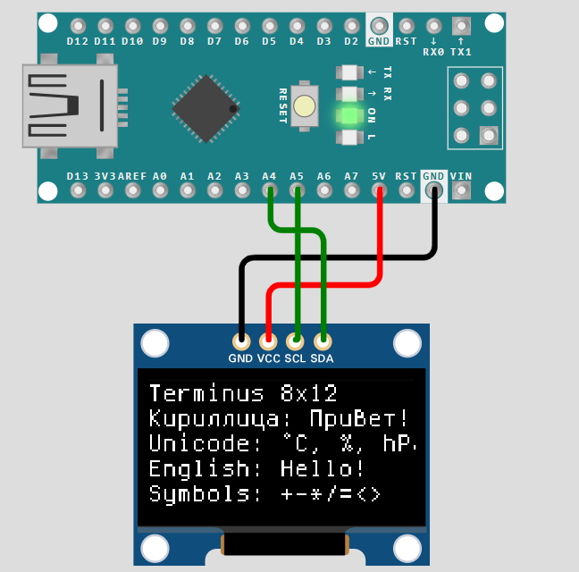

# 📺 OLED2.42_EASY

**Языки:** Русский · [中文](README_CN.md)

[](https://github.com/klenov1900-lang/OLED2.42_EASY/releases)
[](LICENSE)
[](https://www.arduino.cc/)
[](https://www.microchip.com/)
[](https://github.com/klenov1900-lang/OLED2.42_EASY)
[](https://www.arduino.cc/reference/en/libraries/)

Простая библиотека для OLED **2.42"** на контроллере **SSD1309** (I2C, ATmega328P). Использует `I2C_EASY` как низкоуровневый слой TWI. **Без `Wire.h`.** Часть семейства **`*_EASY`**.

---

## 🖼️ Демонстрация

Все примеры протестированы в симуляторе [Wokwi](https://wokwi.com/) и реальном "железе" **Arduino Nano** + **OLED 2.42"** на контроллере **SSD1309** , I2C.

| Часы (`Clock_With_Labels`) | Датчики (`FullDemo`) | Шрифт Terminus (`Text_SmallFont`) |
|:---:|:---:|:---:|
|  |  |  |

> 🧪 *Библиотека проверена в Wokwi на SSD1306 — команды совместимы с SSD1309, поэтому код работает без изменений на реальном "железе" **Arduino Nano** + **OLED 2.42"** на контроллере **SSD1309** , I2C.*

---
## ✨ Особенности

- ✅ **Использует `I2C_EASY`** — без `Wire.h`
- ✅ **Прямая работа с TWI** — только регистры ATmega328P
- ✅ **Framebuffer** — 1024 байта (8 страниц по 128 байт)
- ✅ **Terminus 8×12** — кириллица + Unicode (227 символов)
- ✅ **Blocky 15×23** — крупные цифры, знаки
- ✅ **Мультиязычные заголовки** — русский, English, 中文
- ✅ **Частичное обновление** — `oledShowPage()` — только изменённые страницы
- ✅ **`*Full` + `*Update`** — координаты задаются один раз
- ✅ **Timeout в TWI** — не зависает при отвале дисплея

## 🏗️ Архитектура

```
OLED2.42_EASY
    ↓
I2C_EASY          ← низкоуровневый слой TWI
    ↓
ATmega328P TWI
```

**Как это работает:**
- `OLED2.42_EASY` формирует команды и данные для SSD1309.
- `I2C_EASY` — передаёт их по шине I2C.
- **Прямая работа с регистрами TWI** — без `Wire.h`.

**Преимущества:**
- ✅ Единый TWI-слой для всего семейства `*_EASY`.
- ✅ Нет конфликтов с `DS3231_EASY`, `PCFKeypad_EASY` и др.
- ✅ Timeout + диагностика — от `I2C_EASY`.
- ✅ Минимум кода — только логика SSD1309.

## ⚙️ Требования и совместимость

- **Микроконтроллер:** ATmega328P (8-битный AVR).
- **Платы:** Arduino Uno, Nano, Pro Mini.
- **Дисплей:** OLED 2.42" на контроллере SSD1309.
- **Интерфейс:** I2C (адрес 0x3C по умолчанию).
- **Зависимости:** [`I2C_EASY`](https://github.com/klenov1900-lang/I2C_EASY).
- **Другие платформы:** ESP8266, ESP32, STM32 — **не поддерживаются**.

## 📦 Установка

### Способ 1: Через менеджер библиотек Arduino IDE

1. Откройте Arduino IDE
2. Перейдите в **Скетч → Подключить библиотеку → Управлять библиотеками…**
3. В поиске введите `OLED2.42_EASY`
4. Нажмите **Установить**

> **Примечание:** `I2C_EASY` установится автоматически как зависимость.

### Способ 2: Вручную (через ZIP)

1. Скачайте ZIP-архив с [последней версией](https://github.com/klenov1900-lang/OLED2.42_EASY/archive/refs/heads/main.zip)
2. Arduino IDE: **Скетч → Подключить библиотеку → Добавить .ZIP библиотеку…**
3. Выберите скачанный архив

> **Примечание:** для работы потребуется также установить [`I2C_EASY`](https://github.com/klenov1900-lang/I2C_EASY).

### Способ 3: Через Git

```bash
cd ~/Arduino/libraries/
git clone https://github.com/klenov1900-lang/I2C_EASY.git
git clone https://github.com/klenov1900-lang/OLED2.42_EASY.git
```

## 🚀 Быстрый старт

```c
#include <I2C_EASY.h>
#include <OLED2.42_EASY.h>

void setup() {
    // 1. Инициализация I2C
    i2c_init(400000);

    // 2. Инициализация OLED
    oledBegin();
    oledClear();

    // 3. Вывод текста (Terminus 8×12)
    oledText("OLED 2.42\"", 0, 0);
    oledText("SSD1309 I2C", 0, 1);

    // 4. Вывод значения (Blocky 15×23)
    oledTempFull(23.5, 0, 24, 0, 40, 0);   // 23.5 °C, русский

    // 5. Отправка на дисплей
    oledShow();
}

void loop() {}
```

## 📖 Примеры

| Пример | Описание | Зависимости |
|---|---|---|
| **Text_SmallFont** | Работа со шрифтом Terminus 8×12 | `OLED2.42_EASY` |
| **FullDemo** | Демонстрация `*Full` + `*Update` | `OLED2.42_EASY` |
| **Clock_With_Labels** | Часы с заголовками (ru/en/cn) | `OLED2.42_EASY` |

## 📚 API

### Инициализация

| Функция | Описание |
|---|---|
| `oledBegin()` | Инициализация (адрес 0x3C) |
| `oledBeginAddr(addr)` | Инициализация с другим адресом |

### Управление дисплеем

| Функция | Описание |
|---|---|
| `oledOn()` / `oledOff()` | Вкл / выкл |
| `oledContrast(v)` | Контраст (0..255) |
| `oledInvert(e)` | Инверсия (0/1) |

### Framebuffer

| Функция | Описание |
|---|---|
| `oledClear()` | Очистка всего буфера |
| `oledClearPage(p)` | Очистка страницы 0..7 |
| `oledShow()` | Отправка всего буфера |
| `oledShowPage(p)` | Отправка страницы 0..7 |

### Графика

| Функция | Описание |
|---|---|
| `oledPixel(x, y)` | Пиксель |
| `oledLine(x0, y0, x1, y1)` | Линия |
| `oledRect(x, y, w, h)` | Прямоугольник |
| `oledFillRect(x, y, w, h)` | Залитый прямоугольник |
| `oledCircle(x, y, r)` | Круг |
| `oledFillCircle(x, y, r)` | Залитый круг |
| `oledBitmap(bmp, x, y, w, h)` | Битмап |
| `oledInvertRect(x, y, w, h)` | Инверсия области |

### Текст

| Функция | Описание |
|---|---|
| `oledText(str, x, line)` | Terminus 8×12, строка 0..4 |
| `oledValue(str, x, pos)` | Blocky, pos = 1/2 |
| `oledValueXY(str, x, y)` | Blocky, пиксельная Y |

### Значения с единицами (pos = 1/2)

| Функция | Формат |
|---|---|
| `oledTemp(t, x, pos)` | `+23.5°C` |
| `oledHumid(h, x, pos)` | `67%` |
| `oledPressure(p, x, pos)` | `1013hPa` |
| `oledVolt(v, x, pos)` | `+3.1U` |
| `oledAmper(a, x, pos)` | `+1.2A` |
| `oledTime(h, m, s, x, pos)` | `12:34:56` |
| `oledDate(d, m, y, x, pos)` | `25.09.26` |

### Значения с пиксельными координатами

| Функция | Формат |
|---|---|
| `oledTempXY(t, x, y)` | `+23.5°C` |
| `oledHumidXY(h, x, y)` | `67%` |
| `oledPressXY(p, x, y)` | `1013hPa` |
| `oledVoltXY(v, x, y)` | `+3.1U` |
| `oledAmperXY(a, x, y)` | `+1.2A` |
| `oledTimeXY(h, m, s, x, y)` | `12:34:56` |
| `oledDateXY(d, m, y, x, y)` | `25.09.26` |

### Полные функции (`*Full`)

| Функция | Параметры |
|---|---|
| `oledTempFull(t, hx, hy, vx, vy, lang)` | 6 |
| `oledHumidFull(h, hx, hy, vx, vy, lang)` | 6 |
| `oledPressFull(p, hx, hy, vx, vy, lang)` | 6 |
| `oledVoltFull(v, hx, hy, vx, vy, lang)` | 6 |
| `oledAmperFull(a, hx, hy, vx, vy, lang)` | 6 |
| `oledTimeFull(h, m, s, hx, hy, vx, vy, lang)` | 8 |
| `oledDateFull(d, m, y, hx, hy, vx, vy, lang)` | 8 |

### UPDATE-функции (`*Update`)

| Функция | Описание |
|---|---|
| `oledTempUpdate(t)` | Обновление температуры |
| `oledHumidUpdate(h)` | Обновление влажности |
| `oledPressUpdate(p)` | Обновление давления |
| `oledVoltUpdate(v)` | Обновление напряжения |
| `oledAmperUpdate(a)` | Обновление тока |
| `oledTimeUpdate(h, m, s)` | Обновление времени |
| `oledDateUpdate(d, m, y)` | Обновление даты |

## 📊 Коды ошибок

| Код | Константа | Описание |
|---|---|---|
| 0 | `I2C_OK` | Успех |
| 1 | `I2C_ERR_TIMEOUT` | Таймаут ожидания TWINT |
| 2 | `I2C_ERR_START` | Ошибка START |
| 3 | `I2C_ERR_ADDR_NACK` | Устройство не ответило |
| 4 | `I2C_ERR_DATA_NACK` | NACK на данные |
| 5 | `I2C_ERR_BUS` | Ошибка состояния шины |
| 6 | `I2C_ERR_ARB_LOST` | Потеря арбитража |
| 7 | `I2C_ERR_BUS_LOCKED` | SDA удерживается низко |

## 🔤 Шрифты

| Шрифт | Размер | Назначение | Кириллица |
|---|---|---|---|
| 🔤 **Terminus 8×12** | 8×12 | Текст, заголовки | ✅ |
| 🔢 **Blocky 15×23** | 15×23 | Значения (цифры) | ❌ |

## 💾 Потребление ресурсов

| Ресурс | Занято | Свободно |
|---|---|---|
| ⚡ **Flash** | ~7.8 КБ (25%) | ~23 КБ |
| 💾 **ОЗУ** | ~1.1 КБ (52%) | ~0.9 КБ |

## 📂 Структура

```
OLED2.42_EASY/
├── src/
│   ├── OLED2.42_EASY.h
│   ├── OLED2.42_EASY.cpp
│   ├── fonts.h
│   ├── blocky_font.cpp
│   ├── fonts_terminus_8x12.c
│   └── labels.h
├── examples/
│   ├── Clock_With_Labels/
│   ├── FullDemo/
│   └── Text_SmallFont/
├── images/
│   ├── Clock_With_Labels.png
│   ├── Demo.png
│   └── Text_SmallFont.png
├── library.properties
├── keywords.txt
├── README.md
├── README_CN.md
└── LICENSE
```

## 📝 История версий

| Версия | Дата | Изменения |
|---|---|---|
| **v2.0.0** | 2026-10-16 | Переход на `I2C_EASY`. Убрана зависимость от `util/twi.h`. |
| v1.0.1 | 2026-10-05 | Добавлены примеры и демонстрация. |
| v1.0.0 | 2026-10-04 | Первый релиз. |

## 📄 Лицензия

MIT License. См. [LICENSE](LICENSE).

## 🙏 Credits

| Компонент | Автор | Лицензия |
|---|---|---|
| **Blocky 15×23** | klenov1900-lang | MIT |
| **中文 заголовки** (`labels.h`) | klenov1900-lang | MIT |
| **Terminus 8×12** (адаптирован) | klenov1900-lang | MIT |
| *Оригинальный Terminus* | Dimitar Zhekov | SIL OFL 1.1 |

> **Примечание:** Шрифт Terminus 8×12 был дважды обработан скриптами Python
> (конвертация и оптимизация таблицы глифов). Итоговый шрифт сохраняет стиль
> и геометрию Terminus, но представляет собой адаптированную версию,
> подготовленную автором данной библиотеки.

## 📧 Контакты

- **Email:** gray_wolf19@mail.ru
- **GitHub:** [klenov1900-lang](https://github.com/klenov1900-lang)

---

⭐ Если библиотека вам полезна, поставьте звезду на GitHub! ⭐
